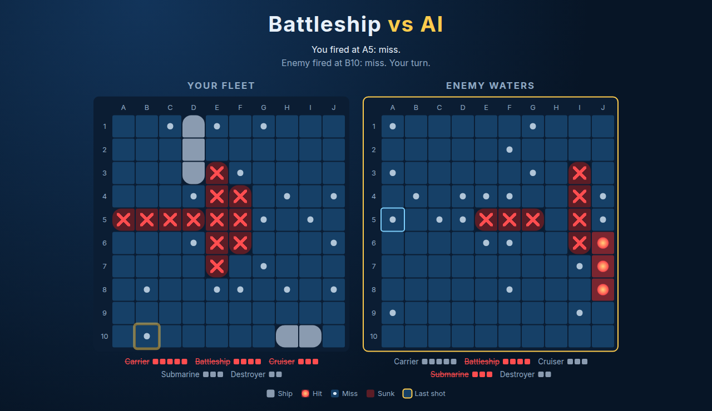

# Battleship vs AI

**▶ Play it: https://rayanmhaidly-ai.github.io/battleship-ai/**

Classic Battleship in the browser against a computer opponent. Nothing to install and no sign-up. It works on desktop and mobile.



## Features

- **Ship placement:** place your five ships by hand (click or tap, press R or tap Rotate to turn them) or randomize them, and move any ship before the battle starts.
- **Score counter:** during battle, a compact bar shows shots fired, hits and accuracy % for you and for the AI, updated after every shot.
- **Restart:** a Restart button is available as soon as the battle starts. It asks for confirmation in the page ("Restart the game? Your current progress will be lost."). Restart takes you back to setup against a fresh enemy fleet. Cancel, Esc or a click outside the dialog returns you to the game exactly as it was. The AI's turn is paused while the dialog is open, so it can't fire after you restart.
- **Touch placement on phones and tablets.** Tap a ship in the tray, then touch your board: the ship appears under your finger and follows it while you drag (Rotate turns it, even mid-drag). Tapping the next ship locks the current one in place; a ship on a red spot never locks. Touch a placed ship to pick it up and drag it, or tap another square. While you hold a ship, touching another placed ship locks the held one (only if it's on green) and picks the touched one up. The page doesn't scroll or zoom while you drag on your board. Mouse placement on desktop is unchanged.
- **Works on mobile:** the boards stack on small screens and everything works by tapping.

## How it was built

I planned the project with [Devin](https://devin.ai), and the work was delivered through reviewed pull requests (starting with [#1](https://github.com/rayanmhaidly-ai/battleship-ai/pull/1)). Each one had to pass CI and was checked in a browser before merging. Every bug found along the way is written up in [BUGS.md](BUGS.md) with its symptom, root cause and fix. Stack: TypeScript (no framework), Vite, Vitest, GitHub Actions and GitHub Pages.

## How the AI plays

The AI plays like a careful human player, and **it can't cheat**: it never sees your board. After each shot it is told only "miss", "hit" or "sunk (length N)", which is exactly what a human opponent would hear.

- **Searching.** Until it finds a ship, it fires in a spaced-out grid instead of at random. While your smallest ship (length 2) is afloat, a checkerboard is guaranteed to touch every ship, so it only needs half the board. As your small ships sink, it spaces its shots further apart, and it skips gaps too small for any ship you have left.
- **Closing in.** After a hit, it tries the neighbouring cells. Once two hits line up, it follows that line and turns around when it reaches a miss or the edge of the board.
- **Finishing the job.** When a ship sinks, it works out which of its hits belonged to that ship. If any hits are left over, another ship is touching it, so it keeps going until that one sinks too.
- **No wasted shots.** It never fires at the same cell twice.

Over 5,000 simulated games it sank the whole fleet in **49 shots on average** (best 21, worst 67). Firing at random takes about 95. The code is in [`src/game/ai.ts`](src/game/ai.ts).

## Tests and CI

Tests ([Vitest](https://vitest.dev)) in [`tests/`](tests/) cover:

- **Rules:** ship placement (no overlaps, nothing off the board), hits, misses, sinking, turn order and winning.
- **AI behaviour:** never repeats a shot (checked over 500 full games), averages under 65 shots, follows up hits correctly and finishes off ships that touch each other.
- **Battle screen:** the score counters after every shot, and Restart, Cancel, Esc and click-outside on the restart dialog, including a restart while the AI is mid-turn. These run against the real page in [jsdom](https://github.com/jsdom/jsdom).
- **No cheating:** the AI's code can't import the board and holds no reference to it. Replaying a game using only the shot results, with no board at all, produces the same moves.

[GitHub Actions](.github/workflows/deploy.yml) runs the tests and a type-checked build on every pull request. Every merge to `main` deploys the site to GitHub Pages.

## Run it locally

Requires Node.js 20 or later (CI uses 22).

```bash
npm install
npm run dev      # http://localhost:5173
npm test         # unit tests
npm run build    # type-check and production build into dist/
```

## Known limits

- **Single player only:** you against the AI. There's no multiplayer, no accounts and no saved stats.
- **One difficulty level.** The AI uses search-and-target rules rather than a full probability model, so a stronger AI is possible.
- **Fixed rules:** a 10×10 board, the standard five-ship fleet and one shot per turn.
- **No backend, by design.** The enemy fleet has to live in your browser's memory, so someone stepping through the code with the DevTools debugger could find it. Simple console tricks are blocked (see [BUGS.md #5](BUGS.md#5-enemy-fleet-placement-could-be-rigged-from-the-browser-console)).
